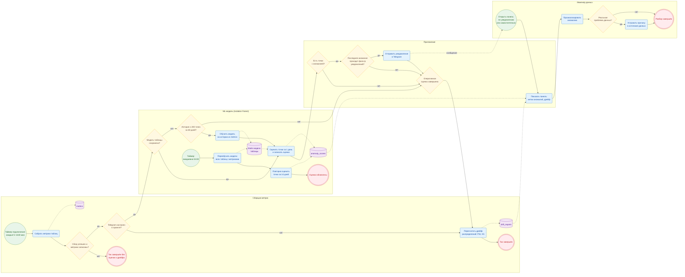

# Место модели поиска аномалий в процессе мониторинга

Схема показывает, где в процессе мониторинга качества данных DB Monitor работает
модель **Isolation Forest**: откуда она получает данные, когда обучается и
оценивает метрики, куда попадают результаты и как ими пользуется инженер данных.

Схема описывает фактическую реализацию (сверено с кодом ветки на коммите
`e65485b`). Это BPMN-подобная диаграмма Mermaid `flowchart`, а не исполняемая
BPMN-модель. Технические детали, которые не нужны для понимания роли модели,
вынесены в [раздел 6](#6-особенности-фактической-реализации).

## Схема

### Условные обозначения

| Элемент | Значение |
|---|---|
| Круг, зелёный | Стартовое событие: таймер сбора, ночной таймер или решение инженера открыть панель |
| Двойной круг, красный | Завершающее событие ветви процесса |
| Прямоугольник со скруглением | Задача |
| Ромб с вопросом | Исключающая развилка: выполняется ровно одна ветвь |
| Ромб без вопроса («Оперативная оценка завершена») | Слияние: сюда сходятся все исходы оценки, после чего процесс продолжается одной веткой |
| Цилиндр | Хранилище данных (таблицы `monitor.db` и файл модели) |
| Сплошная стрелка | Последовательность действий |
| Пунктир без подписи | Запись или чтение данных |
| Пунктир «сообщение» | Уведомление Telegram, передаваемое инженеру |
| Дорожка (рамка) | Участник процесса: сборщик, модель, приложение, инженер |

На схеме три независимых стартовых события. Тик сбора и ночное переобучение
запускает планировщик APScheduler; панель открывает инженер. Ночное
переобучение не продолжает тик сбора, а чтение панели не запускает ни обучение,
ни оценку.

## 1. Назначение модели в процессе мониторинга

Isolation Forest ищет необычные состояния таблицы — резкий рост или падение
числа строк, всплеск доли пустых значений, — не требуя заранее заданных порогов
для каждой таблицы. Для каждой пары «проект — таблица» обучается своя модель.
Результат модели — оценка каждой точки (`score`, значение `decision_function`)
и признак аномалии (`is_anomaly`), которые сохраняются в `anomaly_scores`.
По ним панель мониторинга ставит метки аномалий, а приложение решает,
отправлять ли уведомление в Telegram.

Подробные сведения о модели и её качестве — в [карточке модели](model_card.md).

## 2. Входные признаки

Признаки формирует `_load_features` в
[`ml/anomaly_detector.py`](../ml/anomaly_detector.py) из таблицы `metrics`.
Для каждого момента сбора, где есть обе метрики:

| Признак | Смысл |
|---|---|
| `row_count` | Число строк в таблице |
| `null_rate` | Доля пустых значений |
| `d_row_count` | Изменение `row_count` относительно предыдущего сбора |
| `d_null_rate` | Изменение `null_rate` относительно предыдущего сбора |

Первая точка окна отбрасывается: для неё нельзя вычислить изменение.
Метрики дрейфа (PSI, KS) в модель **не** входят; это отдельный расчёт.

## 3. Принцип обучения и оценки

- **Обучение** (`train`): данные `metrics` за 60 дней, не меньше 200 точек;
  признаки нормируются `StandardScaler`, затем обучается `IsolationForest`
  (100 деревьев, `contamination = 0.01`). Модель и нормировщик сохраняются
  в файл модели таблицы.
- **Оценка** (`score_table`): загружается сохранённая модель; если её нет,
  выполняется обучение по правилу выше. Точка считается аномальной, если модель
  относит её к выбросам (`predict = -1`, что соответствует отрицательному `score`).
- **Оперативная оценка в тике** охватывает точки за последний день; ночная —
  за 14 дней.
- **Недостаток данных** не является сбоем: таблица просто пропускается, сбор
  метрик и расчёт дрейфа продолжаются, модель будет обучена, когда накопится
  история.

## 4. Порядок переобучения

Задача `retrain_anomaly_detectors`
([`collectors/scheduler.py`](../collectors/scheduler.py)) запускается
ежедневно в 04:00 по часовому поясу процесса приложения:

1. Для каждого проекта с сохранёнными метриками и каждой его таблицы модель
   обучается заново на данных за 60 дней (`retrain_all`) и перезаписывает файл
   модели. Таблицы с недостаточной историей пропускаются.
2. Затем точки за 14 дней оцениваются заново, и результаты записываются в
   `anomaly_scores`, чтобы метки на панели соответствовали новой модели.

Ночная задача не проверяет настройку Telegram и не отправляет уведомлений.
Подробная схема — в документе [«Автоматическое переобучение модели»](Model_retrain_BPMN.md).

## 5. Использование результатов и роль инженера

- **Уведомление.** Если в оценённом окне есть аномалии, берётся последняя
  из них. Уведомление отправляется, только если она проходит фильтр:
  `|score| ≥ 0,05` и отклонение `row_count` от медианы за 7 дней не меньше
  10 % (при нехватке точек для медианы проверка отклонения пропускается).
- **Панель мониторинга.** Инженер открывает её, получив уведомление, или
  самостоятельно. Панель читает `anomaly_scores` и `drift_reports`
  (`/api/anomalies`, `/api/drift` в [`app/api.py`](../app/api.py),
  страницы в [`app/dashboard.py`](../app/dashboard.py)); для аномальных точек
  показывается, какой признак сильнее всего отклонился. По запросу инженера
  доступно текстовое объяснение аномалии (`POST /api/explain`, LLM).
- **Решение.** Инженер решает, связана ли аномалия с реальной проблемой
  данных. Если да — устраняет причину в источнике; если нет (ожидаемое
  изменение или ложное срабатывание) — разбор завершается. Отметка решения в
  системе не сохраняется.

## 6. Особенности фактической реализации

1. **Оперативная оценка зависит от Telegram.** В тике сбора
   `_maybe_notify_anomalies` ([`collectors/per_project.py`](../collectors/per_project.py))
   сначала читает настройки Telegram проекта и, если бот или чат не настроены
   (или токен не расшифровывается), завершается до вызова `score_table`.
   Поэтому проект без Telegram получает оценки только после ночного
   переобучения, а модель новой таблицы до 04:00 не обучается. Схема
   показывает это так, как реализовано, хотя архитектурно оценку логичнее
   отделить от уведомлений.
2. **Условие пост-обработки тика** — тик не завершился с ошибкой и сохранил хотя
   бы одну метрику (`rows_saved > 0`). Тогда последовательно
   выполняются оперативная оценка (если настроен Telegram) и пересчёт дрейфа.
3. **Дрейф независим от модели.** `_refresh_drift_cache` пересчитывает PSI и KS
   для таблиц тика и записывает их в `drift_reports` независимо от Telegram
   и результата Isolation Forest. `_refresh_drift_cache` вызывается
   после `_maybe_notify_anomalies`, поэтому на схеме дрейф идёт после оценки.
   Но к нему ведут все исходы: Telegram не настроен, истории не хватает,
   аномалий нет, фильтр не пройден, уведомление отправлено. Ошибки оценки
   перехватываются внутри `_maybe_notify_anomalies` и тоже не мешают расчёту
   дрейфа.
4. **Оценки сохраняются до фильтра уведомлений.** Запись в `anomaly_scores`
   выполняется сразу после оценки, независимо от того, есть ли аномалия и
   будет ли отправлено уведомление.
5. **Повтор уведомлений ограничивается**: по таблице не отправляется больше
   одного уведомления об аномалии за интервал, заданный в настройках
   уведомлений проекта (по умолчанию 30 мин). Каждая попытка отправки фиксируется
   в журнале уведомлений.
6. **Ошибки** подключения к источнику, обучения или отправки сообщения
   записываются в журнал приложения и не останавливают планировщик: ошибка
   оценки одной таблицы не мешает обработке остальных, следующий тик и ночная
   задача запускаются по расписанию.
7. **Режим `legacy`.** Для обратной совместимости работает также глобальная
   задача `collect_all_tables` для проекта `legacy`. Новые проекты обслуживаются
   задачами отдельных подключений, показанными на схеме.

### Соответствие элементов схемы коду

| Элемент схемы | Код |
|---|---|
| Таймер подключения, сбор, запись в `metrics` | `add_job_for_connection`, `collect_for_connection`, `save_metrics` — `collectors/per_project.py` |
| «Сбор успешен и метрики записаны?» | `run_status != "failed"` и `rows_saved > 0` в `collect_for_connection` |
| «Telegram настроен?» | `_maybe_notify_anomalies` → `load_project_telegram_config` (`app/notifications/telegram.py`) |
| Пересчёт дрейфа | `_refresh_drift_cache` → `compute_and_store_drift_all` (`ml/drift.py`) |
| Модель сохранена / обучение / оценка | `score_table`, `train`, `_load_model` — `ml/anomaly_detector.py` |
| Запись оценок | `save_anomaly_scores` в `_maybe_notify_anomalies` и `retrain_anomaly_detectors` |
| Фильтр уведомлений | `_passes_alert_quality_gate` — `collectors/per_project.py`; пороги в `app/config.py` |
| Отправка в Telegram | `notify_anomaly` — `app/notifications/telegram.py` |
| Ночной таймер, переобучение, оценка за 14 дней | `start_scheduler`, `retrain_anomaly_detectors` — `collectors/scheduler.py`; `retrain_all` — `ml/anomaly_detector.py` |
| Панель | `app/dashboard.py`, `/api/anomalies`, `/api/drift`, `/api/explain` — `app/api.py` |

Фильтр уведомлений физически реализован в модуле сборщика, но на схеме
отнесён к дорожке «Приложение», так как относится к логике уведомлений.
