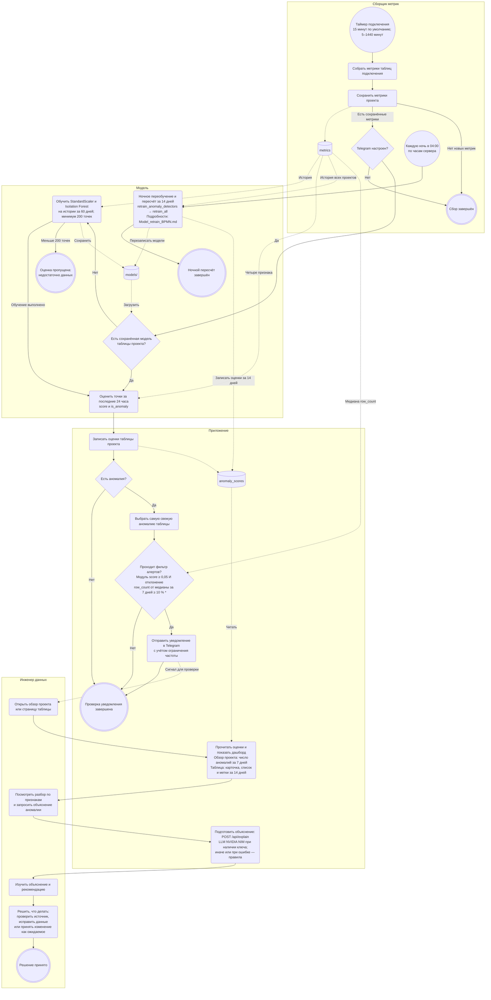

# Место модели поиска аномалий в процессе мониторинга

ДЗ 2, часть 2. Схема описывает основной режим: проекты с подключениями,
сбор по таймеру каждого подключения (`collectors/per_project.py`). Старый
однобазовый режим `legacy` в схему не включён. Для каждой таблицы каждого
проекта используется своя модель Isolation Forest со StandardScaler.

## Схема процесса

Это представление процесса с элементами BPMN средствами Mermaid flowchart.
Сплошные стрелки показывают порядок действий, пунктирные — чтение/запись
данных или передачу сигнала инженеру. Чтение дашборда запускается пользователем
независимо от очередного сбора и наличия уведомлений.

**Легенда:**

| Элемент BPMN | Представление в Mermaid | Пример на схеме |
| --- | --- | --- |
| Дорожка участника | `subgraph id["Название"] … end` | Сборщик метрик, Модель, Приложение, Инженер данных |
| Стартовое событие по таймеру | Круг `id(("…"))` | Таймер подключения; каждую ночь в 04:00 |
| Конечное событие | Двойной круг `id((("…")))` | Решение принято |
| Задача | Скруглённый прямоугольник `id("…")` | Собрать метрики; оценить точки |
| Развилка | Ромб `id{"…"}` | Telegram настроен?; есть аномалия? |
| Хранилище | Цилиндр `id[("…")]` | `metrics`, `anomaly_scores`, `models/` |
| Поток управления | `-->` | Сбор → сохранение |
| Связь с данными или сигнал | `-.->` | Запись оценок; уведомление инженеру |

\* Фильтр `_passes_alert_quality_gate` использует значения по умолчанию из
[`app/config.py`](../app/config.py): `ANOMALY_NOTIFY_MIN_SCORE_MAGNITUDE = 0.05`
и `ANOMALY_NOTIFY_MIN_DELTA_RATIO = 0.1`. Оба условия требуются, когда медиана
и значение `row_count` доступны. Если за 7 дней меньше трёх точек, медиана
равна нулю или `row_count` в момент аномалии отсутствует, проверка отклонения
пропускается, а условие по модулю `score` остаётся обязательным.

Ночной блок раскрывается в [схеме переобучения](Model_retrain_BPMN.md).
Вызов `retrain_anomaly_detectors` из [`collectors/scheduler.py`](../collectors/scheduler.py)
переобучает модели всех проектов, перезаписывает файлы в `models/` и сохраняет
оценки за 14 дней. Для проектов без Telegram это единственный автоматический
источник оценок в основном режиме. Ручной запуск — `make warmup-ml PROJECT_ID=<id>`.

## Какую задачу в процессе решает модель

Модель находит необычные состояния таблицы по истории её метрик, чтобы инженер
мог заметить возможные сбои загрузки, пропуски данных или неожиданный рост.
Она выполняется после сбора и до отбора уведомлений; дашборд читает уже
сохранённые результаты. Код — [`ml/anomaly_detector.py`](../ml/anomaly_detector.py).

Для каждой точки возвращаются `score` — значение `decision_function`
(округлённое до шести знаков при сохранении результата) — и флаг `is_anomaly`.
Отрицательный результат функции соответствует аномалии. Оценка не является
вероятностью ошибки или доказательством сбоя: окончательное решение принимает
инженер. Разметки реальных аномалий нет; в [`tests/ml_golden/`](../tests/ml_golden/)
есть синтетические наборы, включая известный всплеск `row_count` и `null_rate`.
Подробное описание модели: [карточка модели](model_card.md).

## Почему здесь целесообразен ML, а не фиксированные пороги

У каждой таблицы свой обычный уровень и ритм изменений. Порог «больше X»
пришлось бы вручную подбирать для каждой таблицы и метрики, а затем менять
при изменении нагрузки. Модель учится на истории самой таблицы и учитывает
сочетания признаков: например, рост числа строк вместе с ростом доли пустых
значений может быть необычным, даже если отдельные значения не пересекли
фиксированные пороги.

Isolation Forest работает без размеченных реальных аномалий. Здесь ритм
отражается в исторических значениях и изменениях метрик: отдельных календарных
признаков у модели нет. Фиксированные пороги всё же используются после модели
для отбора значимых Telegram-уведомлений; они не меняют оценки на дашборде.

## Какие данные поступают на вход

Сборщик сохраняет агрегированные метрики таблицы в `metrics` с интервалом
подключения: по умолчанию 15 минут, допустимо от 5 до 1440 минут.
Модель получает четыре признака:

| Признак | Значение |
| --- | --- |
| `row_count` | Число строк таблицы в момент замера |
| `null_rate` | Доля пустых значений |
| `d_row_count` | Разность `row_count` текущего и предыдущего замера |
| `d_null_rate` | Разность `null_rate` текущего и предыдущего замера |

Берутся только замеры, в которых обе метрики доступны на одной временной
метке. После вычисления разностей первый замер исключается. StandardScaler
обучается на истории и затем применяется к признакам при оценке; на новых
точках он не обучается заново.

Параметры по умолчанию из [`ml/settings.py`](../ml/settings.py), переопределяемые
переменными `ML_ANOMALY_*`: 100 деревьев, `contamination = 0.01`,
`random_state = 42`, окно обучения 60 дней, минимум 200 точек с четырьмя
признаками после подготовки данных. Если сохранённой модели нет, первая
оценка пытается обучить её на этой истории. При недостатке данных таблица
пропускается до накопления истории, а не объявляется нормальной.

## Как результат используется дальше

После успешного сбора с новыми метриками и при настроенном Telegram
[`collectors/per_project.py`](../collectors/per_project.py) оценивает последние
24 часа для собранных таблиц. Пары `score` и `is_anomaly` записываются в
`anomaly_scores` с привязкой к проекту, таблице и времени **до** фильтра алертов.
Ночью после переобучения оценки за 14 дней обновляются для всех проектов.

- **Обзор проекта:** [`app/dashboard.py`](../app/dashboard.py) читает число
  точек с `is_anomaly = 1` за 7 дней.
- **Страница таблицы:** [`templates/table_detail.html`](../templates/table_detail.html)
  запрашивает `GET /api/anomalies/<table>?range=14d` для карточки, списка
  и меток на графике. [`app/api.py`](../app/api.py) читает сохранённые оценки
  и добавляет для аномальных точек разбор признаков: значения, z-оценки
  относительно обученного StandardScaler и `top_feature` — признак с
  наибольшим модулем z-оценки. Это описание отклонения, а не доказательство причины.
- **Telegram:** из аномальных точек за последние 24 часа выбирается самая
  свежая по каждой таблице. Уведомление отправляется только после
  `_passes_alert_quality_gate`, с учётом ограничения частоты уведомлений.
  Если фильтр отсёк точку, её оценка и флаг остаются доступны на дашборде.
- **Объяснение и действие инженера:** по запросу `POST /api/explain` приложение
  возвращает объяснение и рекомендацию через LLM NVIDIA NIM, если задан ключ;
  без ключа или при ошибке сервиса использует правила. Инженер сопоставляет
  объяснение с разбором признаков и решает, нужна ли проверка источника,
  исправление данных или изменение считается ожидаемым.

Смежные документы ДЗ 2: [карточка модели](model_card.md) и
[схема переобучения](Model_retrain_BPMN.md). Карточка модели добавлена; схема переобучения пока ожидает добавления
по задаче #45, ссылка указывает на предусмотренный заданием путь.
