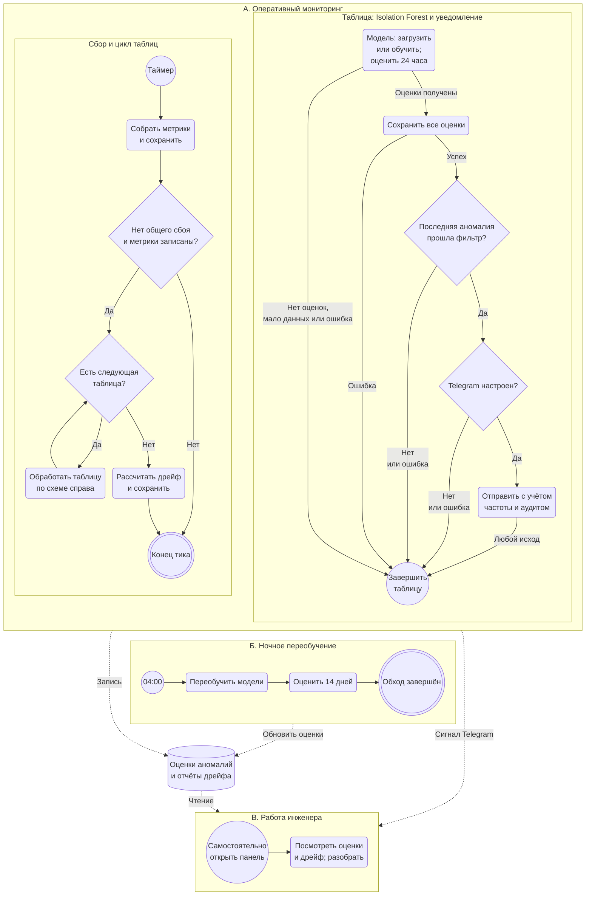

# Место модели поиска аномалий в процессе мониторинга

ДЗ 2, часть 2. Схема описывает основной режим: проекты с подключениями,
сбор по таймеру каждого подключения (`collectors/per_project.py`). Старый
однобазовый режим `legacy` в схему не включён. Для каждой таблицы каждого
проекта используется своя модель Isolation Forest со StandardScaler.

Сверено 24 октября 2026 года с кодом
[`8d1c53d`](https://github.com/ksdergach/db-monitoring-production-standards/tree/8d1c53df4710fec8cef2b48d0f2021c25faad916).
Ниже описана реализация после исправления #54: Telegram влияет только на
уведомления, а не на оценку и сохранение результатов модели.

## Схема процесса

Это представление процесса с элементами BPMN средствами Mermaid flowchart.
Сплошные стрелки показывают порядок действий, пунктирные — чтение/запись
данных или передачу сигнала инженеру. Чтение дашборда запускается пользователем
независимо от очередного сбора и наличия уведомлений.

**Как читать схему.** В области **А** слева показан сбор и единственный цикл
обхода таблиц; справа — детализация шага «Обработать таблицу», а не второй
процесс или повторный анализ. После любого выхода «Завершить таблицу» управление
возвращается к ромбу «Есть следующая таблица?». Только ответ «Нет» запускает
дрейф всех таблиц подключения. При общем сбое сбора или отсутствии записанных
метрик тик завершается без постобработки.

В детализации сначала работает **Isolation Forest**: загружается модель,
а при её отсутствии выполняется обучение по истории проекта; затем оцениваются
последние 24 часа. Ветка «Мало данных или ошибка» означает недостаток истории для обучения,
недостаток данных для оценки либо ошибку модели. Пустой результат оценки также
завершает текущую таблицу. Ошибка сохранения оценок ведёт к тому же выходу.
Минимумы обучения и оценки различаются и приведены ниже.

После успешной записи **всех** оценок выбирается последняя аномалия и применяется
действующий фильтр. Ответ «Нет» у фильтра включает отсутствие аномалий.
Telegram проверяется только после этих действий; его ветка «Нет или ошибка» включает
отсутствие токена или чата, ошибку чтения настроек или расшифровки. Ошибка
фильтра, ограничение частоты, успешная или неудачная отправка тоже завершают
текущую таблицу с переходом к следующей. Ошибки журналируются; они не отменяют
последующий расчёт дрейфа. Попытки доставки фиксируются в существующем журнале;
при срабатывании ограничения частоты попытка не создаётся.

Области **Б** и **В** независимы от оперативного цикла. Ночной процесс обновляет
только оценки аномалий. Общий цилиндр обозначает сохранённые результаты:
`anomaly_scores` и `drift_reports`. Пунктирные связи — данные и необязательный
сигнал Telegram, а не запуск следующего процесса. Инженер самостоятельно
открывает панель; чтение результатов Isolation Forest не запускает обучение
или повторную оценку этой моделью. Разбор признаков вычисляется отдельно
при чтении аномальных точек и не меняет сохранённые оценки.

**Легенда:**

| Элемент | Значение на схеме |
| --- | --- |
| Цветная область `subgraph` | Один из трёх процессов; вложенные области в А — цикл и его детализация |
| Круг | Старт по таймеру или самостоятельное открытие панели |
| Круг «Завершить таблицу» | Локальный выход: вернуться к проверке следующей таблицы |
| Двойной круг | Конец тика сбора или ночного обхода |
| Скруглённый прямоугольник | Действие или раскрываемый шаг «Обработать таблицу» |
| Ромб | Проверка; подпись выхода задаёт условие перехода |
| Цилиндр | Сохранённые оценки аномалий и отчёты дрейфа |
| Сплошная стрелка `-->` | Порядок действий; обратная стрелка от обработки таблицы — продолжение цикла |
| Пунктирная стрелка `-.->` | Запись, чтение результатов или необязательный сигнал инженеру |

Фильтр `_passes_alert_quality_gate` использует значения по умолчанию из
[`app/config.py`](../app/config.py): `ANOMALY_NOTIFY_MIN_SCORE_MAGNITUDE = 0.05`
и `ANOMALY_NOTIFY_MIN_DELTA_RATIO = 0.1`. Оба условия требуются, когда медиана
и значение `row_count` доступны. Если за 7 дней меньше трёх точек, медиана
равна нулю или `row_count` в момент аномалии отсутствует, проверка отклонения
пропускается, а условие по модулю `score` остаётся обязательным.

Ночной блок раскрывается в [схеме переобучения](Model_retrain_BPMN.md).
Вызов `retrain_anomaly_detectors` из [`collectors/scheduler.py`](../collectors/scheduler.py)
обходит проекты с сохранёнными метриками. Для каждого проекта сначала
выполняется обучение его таблиц, затем — пересчёт оценок за 14 дней.
Успешно обученные модели сохраняются в `models/`; при недостатке истории
обучение таблицы пропускается. Пересчёт оценок всё равно пытается использовать
доступную модель, поэтому «Обход завершён» не означает, что все таблицы успешно
переобучены и оценены. Ночной пересчёт независим от оперативной оценки и не
отправляет уведомлений. Ручной запуск — `make warmup-ml PROJECT_ID=<id>`.

## Какую задачу в процессе решает модель

Модель находит необычные состояния таблицы по истории её метрик, чтобы инженер
мог заметить возможные сбои загрузки, пропуски данных или неожиданный рост.
Она выполняется после сбора и до отбора уведомлений; дашборд читает уже
сохранённые результаты. Код — [`ml/anomaly_detector.py`](../ml/anomaly_detector.py).

Для каждой точки возвращаются `score` — значение `decision_function`
(округлённое до шести знаков при сохранении результата) — и флаг `is_anomaly`.
Отрицательный результат функции соответствует аномалии. Оценка не является
вероятностью ошибки или доказательством сбоя: окончательное решение принимает
инженер. Разметки реальных аномалий нет; в [`tests/ml_golden/`](../tests/ml_golden/)
есть синтетические наборы, включая известный всплеск `row_count` и `null_rate`.
Подробное описание модели: [карточка модели](model_card.md).

## Почему здесь целесообразен ML, а не фиксированные пороги

У каждой таблицы свой обычный уровень и ритм изменений. Порог «больше X»
пришлось бы вручную подбирать для каждой таблицы и метрики, а затем менять
при изменении нагрузки. Модель учится на истории самой таблицы и учитывает
сочетания признаков: например, рост числа строк вместе с ростом доли пустых
значений может быть необычным, даже если отдельные значения не пересекли
фиксированные пороги.

Isolation Forest работает без размеченных реальных аномалий. Здесь ритм
отражается в исторических значениях и изменениях метрик: отдельных календарных
признаков у модели нет. Фиксированные пороги всё же используются после модели
для отбора значимых Telegram-уведомлений; они не меняют оценки на дашборде.

## Какие данные поступают на вход

Сборщик сохраняет агрегированные метрики таблицы в `metrics` с интервалом
подключения: по умолчанию 15 минут, допустимо от 5 до 1440 минут.
Модель получает четыре признака:

| Признак | Значение |
| --- | --- |
| `row_count` | Число строк таблицы в момент замера |
| `null_rate` | Доля пустых значений |
| `d_row_count` | Разность `row_count` текущего и предыдущего замера |
| `d_null_rate` | Разность `null_rate` текущего и предыдущего замера |

Берутся только замеры, в которых обе метрики доступны на одной временной
метке. После вычисления разностей первый замер исключается. StandardScaler
обучается на истории и затем применяется к признакам при оценке; на новых
точках он не обучается заново.

Параметры по умолчанию из [`ml/settings.py`](../ml/settings.py), переопределяемые
переменными `ML_ANOMALY_*`: 100 деревьев, `contamination = 0.01`,
`random_state = 42`, окно обучения 60 дней, минимум **200 строк признаков**,
то есть минимум **201 согласованный замер** обеих метрик до исключения первого
замера при вычислении разностей. Если сохранённой модели нет, первая
оценка пытается обучить её на этой истории. При недостатке данных таблица
пропускается до накопления истории, а не объявляется нормальной.

Готовой модели для оценки достаточно **двух согласованных замеров** в окне
24 часа: после вычисления разностей остаётся одна строка признаков. Минимум
200 строк относится только к обучению. Недостаток данных не считается
ошибкой всего сбора и не означает, что таблица признана нормальной.

## Как результат используется дальше

После сбора, не завершившегося общим сбоем, с новыми метриками
[`collectors/per_project.py`](../collectors/per_project.py) оценивает последние
24 часа для собранных таблиц. Пары `score` и `is_anomaly` записываются в
`anomaly_scores` с привязкой к проекту, таблице и времени **до** фильтра алертов.
Ночью после переобучения оценки за 14 дней обновляются для всех проектов.

Условие постобработки в `collect_for_connection` — `run_status != "failed"`
и `rows_saved > 0`. Частичный успех со статусом `warning` сохраняет обработку;
общий сбой или отсутствие записанных метрик пропускают и оценку, и дрейф.
Для каждой обработанной таблицы `_maybe_notify_anomalies` сначала вызывает
`score_table(window_days=1)` и `save_anomaly_scores`, затем отдельный этап
`_notify_latest_anomaly` выбирает последнюю аномалию, применяет неизменный
фильтр и загружает проектную конфигурацию Telegram. Все операции используют
`project_id`; повторная оценка обновляет ключ «проект — таблица — время».

Ошибка оценки или записи пропускает только текущую таблицу. Ошибки фильтра,
настроек и отправки журналируются с маскированием секретов, следующие таблицы
продолжают обрабатываться. После обхода `_refresh_drift_cache` рассчитывает
PSI/KS; `finally` в сборщике обеспечивает его вызов даже при неожиданном
исключении всего этапа оценки. Расчёт дрейфа не использует модель.
Схема показывает Isolation Forest для подключений проектов. Режим `legacy`
и отдельный поиск точек излома здесь не раскрываются. Для читаемости схема
не показывает записи `metrics` и файлов моделей отдельными цилиндрами;
они описаны выше.

- **Обзор проекта:** [`app/dashboard.py`](../app/dashboard.py) читает число
  точек с `is_anomaly = 1` за 7 дней.
- **Страница таблицы:** [`templates/table_detail.html`](../templates/table_detail.html)
  запрашивает `GET /api/anomalies/<table>?range=14d` для карточки, списка
  и меток на графике. [`app/api.py`](../app/api.py) читает сохранённые оценки
  и добавляет для аномальных точек разбор признаков: значения, z-оценки
  относительно обученного StandardScaler и `top_feature` — признак с
  наибольшим модулем z-оценки. Это описание отклонения, а не доказательство причины.
- **Telegram:** из аномальных точек за последние 24 часа выбирается самая
  свежая по каждой таблице. Уведомление отправляется только после
  `_passes_alert_quality_gate` и проверки Telegram текущего проекта, с учётом
  ограничения частоты уведомлений. Отсутствие настроек, токена или чата,
  ошибка расшифровки либо доставки влияют только на уведомление.
  Если фильтр отсёк точку, её оценка и флаг остаются доступны на дашборде.
- **Объяснение и действие инженера:** по запросу `POST /api/explain` приложение
  возвращает объяснение и рекомендацию через LLM NVIDIA NIM, если задан ключ;
  без ключа или при ошибке сервиса использует правила. Инженер сопоставляет
  объяснение с разбором признаков и решает, нужна ли проверка источника,
  исправление данных или изменение считается ожидаемым.

## Соответствие схемы коду

| Шаг схемы | Реализация |
| --- | --- |
| Таймер, сбор и условие «Нет общего сбоя и метрики записаны?» | `add_job_for_connection`, `collect_for_connection`: `run_status != "failed"`, затем `rows_saved > 0` — [`collectors/per_project.py`](../collectors/per_project.py) |
| Цикл таблиц, оценка 24 часов и сохранение всех оценок | `_maybe_notify_anomalies` → `score_table(window_days=1)` → `save_anomaly_scores`; исключение или недостаток данных пропускает текущую таблицу |
| Загрузка модели и обучение при её отсутствии | `score_table`, `_load_model`, `train`, `_load_features` — [`ml/anomaly_detector.py`](../ml/anomaly_detector.py); минимумы обучения задаёт [`ml/settings.py`](../ml/settings.py) |
| Последняя аномалия, фильтр и проверка Telegram | `_notify_latest_anomaly` → `_passes_alert_quality_gate` → `_load_telegram_config` — [`collectors/per_project.py`](../collectors/per_project.py) |
| Доставка и журнал попыток | `notify_anomaly` — [`app/notifications/telegram.py`](../app/notifications/telegram.py); ограничение частоты проверяется до попытки отправки |
| Дрейф после обхода таблиц | `_refresh_drift_cache` вызывается в `finally` после этапа оценки → `compute_and_store_drift_all` — [`ml/drift.py`](../ml/drift.py) |
| Ночной обход в 04:00 и пересчёт 14 дней | `start_scheduler`, `retrain_anomaly_detectors` — [`collectors/scheduler.py`](../collectors/scheduler.py) |
| Чтение результатов и разбор инженером | [`app/dashboard.py`](../app/dashboard.py), `/api/anomalies/<table>`, `/api/drift/<table>`, `/api/explain` — [`app/api.py`](../app/api.py) |

Смежные документы ДЗ 2: [карточка модели](model_card.md) и
[схема переобучения](Model_retrain_BPMN.md).
