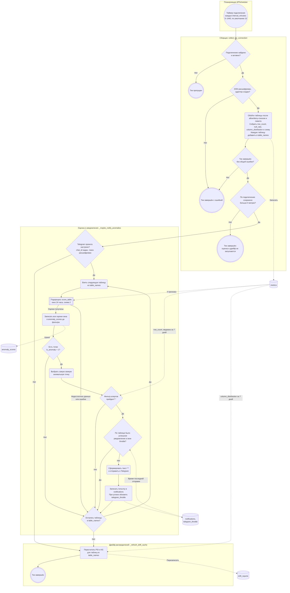
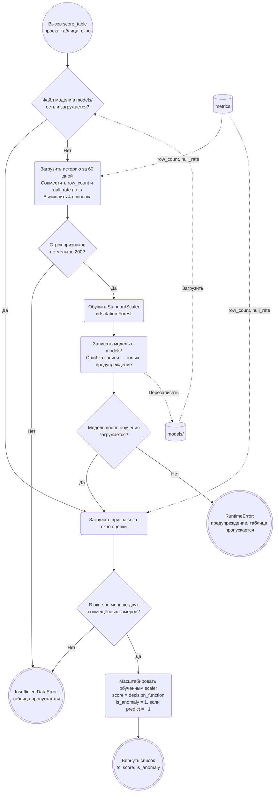
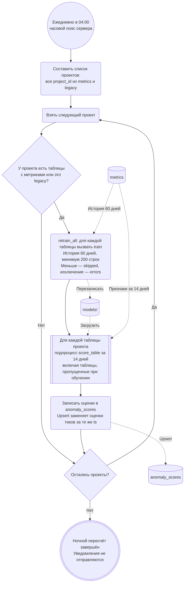
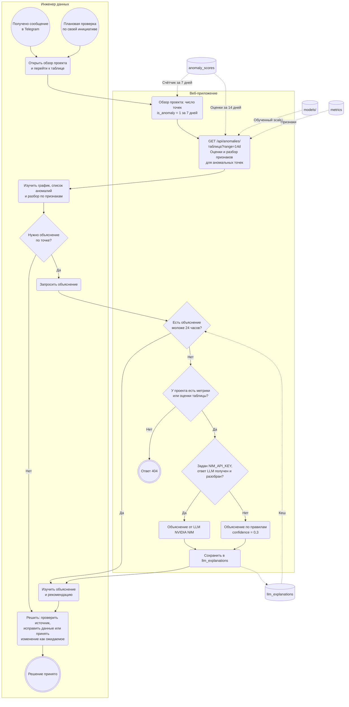

# Место модели поиска аномалий в процессе мониторинга

ДЗ 2, часть 2. Документ описывает **фактическую реализацию** эксплуатации модели
Isolation Forest в DB Monitor. Дата сверки с кодом: **19 октября 2026 года**,
основная ветка — коммит `f6b5747`. Описание построено по исходному коду, а не
по предполагаемой архитектуре; спорные места кода вынесены в раздел
[«Недостатки реализации»](#недостатки-реализации-для-отдельных-задач) и
в рамках этого документа не исправлялись.

**Область описания.** Основной режим: проекты с подключениями, у каждого активного
подключения своя задача сбора `collect:<project_id>:<connection_id>`
([`collectors/per_project.py`](../collectors/per_project.py)). Единица модели —
пара **«проект, таблица»**: у каждой свой файл
`models/<project>__<table>__anomaly.joblib` со StandardScaler и Isolation Forest.

Не показаны на схемах, но работают параллельно и **не связаны с Isolation Forest**:
прогноз (Prophet, 03:00), поиск точек излома (каждый час), сбор схемы и
уведомления о дрейфе схемы, очистка журнала входов. Глобальная задача
`collect_all_tables` (тенант `legacy`) зарегистрирована и в основном режиме,
см. [замечание о `legacy`](#режим-legacy).

## Состав схем

Процесс разбит на четыре связанные схемы, чтобы ни одна стрелка не пересекала
несвязанные шаги:

1. [Тик сбора подключения](#1-тик-сбора-подключения) — сбор, проверка Telegram,
   оценка последних 24 часов, отбор и отправка уведомлений, пересчёт дрейфа.
2. [Подпроцесс `score_table`](#2-подпроцесс-оценки-score_table) — загрузка
   или обучение модели и расчёт оценок; общий для тика, ночи и ручного прогрева.
3. [Ночное переобучение](#3-ночное-переобучение-и-пересчёт-оценок) — обучение
   моделей всех проектов и пересчёт оценок за 14 дней.
4. [Работа инженера с результатами](#4-работа-инженера-с-результатами) — дашборд,
   разбор признаков и объяснение аномалии.

## 1. Тик сбора подключения

Код: `collect_for_connection` и `_maybe_notify_anomalies`, `_passes_alert_quality_gate`,
`_refresh_drift_cache` в [`collectors/per_project.py`](../collectors/per_project.py);
`notify_anomaly` и `load_project_telegram_config` в
[`app/notifications/telegram.py`](../app/notifications/telegram.py).

**Как читать ветвления.**

- *Подключение найдено и активно* — удалённое или выключенное подключение
  завершает тик без сбора. *DSN расшифрован, адаптер создан* — ошибка расшифровки
  DSN или токена Iceberg либо создания движка завершает тик со статусом `failed`.
- *Тик завершён без общей ошибки* — ошибка одной таблицы не прерывает тик:
  таблица получает статус `failed` в журнале запуска, а тик — `warning`. Общее
  исключение вне обработки таблиц даёт `failed`, и дальше ничего не запускается.
- *По подключению сохранено больше 0 метрик* — проверяется счётчик `rows_saved`
  **всего подключения**, а не отдельной таблицы. В `table_names` попадают все
  таблицы, прошедшие allow/deny-списки и лимит, в том числе пропущенные по размеру
  или с ошибкой сбора; для них используется уже накопленная история.
  Подключение в режиме `metadata_only_mode` не сохраняет метрики, поэтому
  оценка и дрейф для него не запускаются.
- *Telegram проекта настроен* — `load_project_telegram_config` возвращает
  конфигурацию, только если в `project_notifications` есть токен и `chat_id`
  и токен расшифровывается. **Это условие стоит перед оценкой моделью:**
  без Telegram Isolation Forest в тике не вызывается, оценки не пишутся,
  а модель не обучается при первом сборе. Для такого проекта оценки появляются
  только после [ночного пересчёта](#3-ночное-переобучение-и-пересчёт-оценок)
  или ручного прогрева.
- *Недостаточно данных или ошибка* — `InsufficientDataError` пропускает таблицу
  без записи в лог, прочие исключения записываются как предупреждение. В обоих
  случаях обработка переходит к следующей таблице, а не завершает тик.
- *Фильтр алертов* и *окно throttle* влияют только на отправку. Оценки и флаги
  уже записаны в `anomaly_scores` и видны на дашборде.
- *Пересчёт дрейфа* выполняется после блока уведомлений **независимо от Telegram**
  и от результатов модели: PSI и KS считаются по снимкам `column_distribution`
  из `metrics` и перезаписывают кеш `drift_reports` (код —
  [`ml/drift.py`](../ml/drift.py)). Дрейф не является признаком Isolation Forest,
  а оценки модели не используются для дрейфа. Уведомлений о дрейфе распределений
  нет.

\* **Фильтр алертов** `_passes_alert_quality_gate` использует значения по умолчанию
из [`app/config.py`](../app/config.py): `ANOMALY_NOTIFY_MIN_SCORE_MAGNITUDE = 0.05`
и `ANOMALY_NOTIFY_MIN_DELTA_RATIO = 0.10`. Сначала требуется `|score| ≥ 0,05`.
Затем, если медиана `row_count` за 7 дней вычислима и не равна нулю и есть
значение `row_count` на момент аномалии, требуется отклонение от медианы не менее
10 %. Если за 7 дней меньше трёх точек, медиана равна нулю или значения
`row_count` на момент аномалии нет, проверка отклонения пропускается.

\** **Текст уведомления** `notify_anomaly`: проект, таблица, метрика `row_count`,
время, `score`. При включённом флаге `FF_LLM_NOTIFICATIONS` (по умолчанию выключен)
к тексту добавляется объяснение LLM, если его уверенность выше уровня правил (0,3);
иначе — «Требуется ручная проверка данных». Окно throttle берётся из настроек
проекта, по умолчанию 30 минут, и считается по паре «проект, таблица» для события
`anomaly`. Каждая попытка записывается в `notifications` со статусом `sent` или
`failed`; `telegram_throttle` обновляется только после успешной отправки.

## 2. Подпроцесс оценки score_table

Код: `score_table`, `train`, `_load_features` в
[`ml/anomaly_detector.py`](../ml/anomaly_detector.py). Вызывается с окном 24 часа
из тика (схема 1) и с окном 14 дней из ночной задачи (схема 3) и ручного прогрева.

- Признаки: `row_count`, `null_rate`, `d_row_count`, `d_null_rate`. Берутся только
  временные метки, на которых есть обе метрики; первая точка после вычисления
  разностей отбрасывается.
- Если файл записать не удалось, но на диске остался прежний файл, следующий шаг
  загрузит **прежнюю** модель. Если файла нет совсем, вызов завершается
  `RuntimeError`.
- Если модель есть, но в окне оценки меньше двух совмещённых замеров, вызывается
  та же `InsufficientDataError`: таблица пропускается, хотя модель обучена.
- Вне схемы: прочие исключения обучения или чтения метрик передаются вызывающему
  коду, который пишет предупреждение и переходит к следующей таблице.
- `score` округляется до шести знаков. Отрицательный `score` соответствует
  аномалии; это не вероятность сбоя.

## 3. Ночное переобучение и пересчёт оценок

Код: `retrain_anomaly_detectors` и `_iter_retrain_projects` в
[`collectors/scheduler.py`](../collectors/scheduler.py), `retrain_all` в
[`ml/anomaly_detector.py`](../ml/anomaly_detector.py). Подробный разбор и
предлагаемые проверки качества — в [схеме переобучения](Model_retrain_BPMN.md).

- **Триггер:** только cron 04:00 по часовому поясу процесса приложения
  (APScheduler `BackgroundScheduler` без явной зоны). Проверки дрейфа, точек излома
  или качества модели перед запуском нет.
- **Данные:** все проекты, у которых есть строки в `metrics`, независимо от
  настройки Telegram; таблицы проекта берутся из `metrics`, а не из текущего
  списка таблиц подключения.
- **Сохранение:** `train` сразу перезаписывает рабочий файл модели; версий и
  отката нет. Если таблица пропущена из-за нехватки данных или ошибки, её прежний
  файл не меняется и **используется для пересчёта за 14 дней**. Если файла нет,
  `score_table` повторяет попытку обучения.
- **Повторная оценка:** пересчитываются оценки за 14 дней, а не метрики качества.
  Ночная задача не вызывает фильтр алертов и Telegram.
- **Ручной запуск:** `make warmup-ml PROJECT_ID=<id>` вызывает
  [`scripts/warmup_ml.py`](../scripts/warmup_ml.py): для одного проекта выполняет
  то же обучение и пересчёт за 14 дней, а также точки излома, прогноз и кеш дрейфа.
- **Обучение по требованию** происходит внутри `score_table` (схема 2), если файла
  модели нет: в тике проекта с Telegram или в ночном и ручном пересчёте.

## 4. Работа инженера с результатами

Код: [`app/dashboard.py`](../app/dashboard.py), `anomalies` и `explain` в
[`app/api.py`](../app/api.py), [`app/llm.py`](../app/llm.py),
[`templates/table_detail.html`](../templates/table_detail.html).

- Дашборд и API **только читают** сохранённые оценки: открытие страницы не
  запускает модель и не обучает её. Пустой список значит, что оценок за период ещё
  нет (нет Telegram и не было ночного пересчёта, мало истории и т. п.).
- Разбор признаков `feature_breakdown` считается при запросе: значения четырёх
  признаков, z-оценки относительно сохранённого StandardScaler и `top_feature` —
  признак с наибольшим модулем z-оценки. Если файла модели нет, разбора нет.
  Это описание отклонения, а не доказательство причины.
- Сообщение в Telegram — сигнал, а не обязательный старт: инженер приходит
  к тем же данным и при плановой проверке. Сообщение отправляется только после
  фильтра алертов и throttle (схема 1).
- Окончательное решение принимает инженер; модель не меняет данные и не
  блокирует загрузки.

## Легенда

Схемы — Mermaid flowchart с элементами BPMN, а не исполняемая BPMN-модель.

| Элемент BPMN | Представление в Mermaid | Пример на схемах |
| --- | --- | --- |
| Дорожка участника | `subgraph id["Название"] … end` | Сборщик, Оценка и уведомления, Инженер данных |
| Стартовое событие (таймер, сообщение, вызов) | Круг `id(("…"))` | Таймер подключения; 04:00; сообщение в Telegram |
| Конечное событие | Двойной круг `id((("…")))` | Тик завершён; решение принято |
| Задача | Скруглённый прямоугольник `id("…")` | Записать оценки; пересчитать PSI и KS |
| Вызов подпроцесса | Прямоугольник с полосами `id[["…"]]` | Подпроцесс `score_table` |
| Эксклюзивный шлюз | Ромб `id{"…"}` | Telegram настроен?; фильтр алертов пройден? |
| Хранилище данных | Цилиндр `id[("…")]` | `metrics`, `anomaly_scores`, `models/` |
| Поток управления | Сплошная стрелка `-->` с условием ветви | Да / Нет у шлюзов |
| Поток данных | Пунктирная стрелка `-.->` | Чтение признаков; запись оценок |

Правила оформления: у каждого шлюза подписаны все исходящие ветви; цикл по таблицам
и проектам показан явной обратной стрелкой «Да» от шлюза «Остались …?»; хранилища
вынесены за пределы дорожек, потому что их используют несколько участников;
сообщение в Telegram связывает схемы 1 и 4 через стартовое событие инженера, а не
через прямую стрелку между диаграммами.

## Результаты сверки прежней схемы с кодом

| № | Что было в прежней схеме | Что в коде | Исправление |
| --- | --- | --- | --- |
| 1 | Шлюз «Telegram настроен?» в дорожке сборщика; ветка «Да» — отдельная стрелка вне дорожек к «Есть сохранённая модель?» | Проверка выполняется в `_maybe_notify_anomalies` до вызова `score_table` | Шлюз перенесён в дорожку «Оценка и уведомления» и стоит перед подпроцессом |
| 2 | «Telegram: Нет» → «Сбор завершён» | После блока уведомлений всегда вызывается `_refresh_drift_cache` | Ветка «Нет» ведёт к пересчёту дрейфа; дрейф показан отдельной дорожкой |
| 3 | «Нет новых метрик» → завершение, без ошибок подключения | Условие — `rows_saved > 0` по всему подключению; есть выходы для неактивного подключения, ошибки DSN и общей ошибки тика | Добавлены шлюзы «найдено и активно», «DSN расшифрован», «без общей ошибки» |
| 4 | Нет цикла по таблицам: «Нет аномалии» завершало весь процесс | Обход всех `table_names`, пропуск таблицы при ошибке | Добавлен шлюз «Остались таблицы?» с обратной ветвью |
| 5 | «Меньше 200 точек» — конечное событие всего процесса | `InsufficientDataError` пропускает только таблицу; возникает и при обученной модели, если в окне меньше двух замеров | Отдельный подпроцесс `score_table` с обоими условиями |
| 6 | Круг данных `train → models → saved_model`; ветки ошибки записи нет | `train` пишет файл, затем `score_table` загружает его повторно; ошибка записи — предупреждение, затем `RuntimeError` или старая модель | Шлюз «Модель после обучения загружается?» и пояснение |
| 7 | «Отправить с учётом ограничения частоты» — одна задача | Сначала `is_throttled`, затем отправка, аудит в `notifications`, обновление `telegram_throttle` только при успехе; LLM в тексте под флагом | Шлюз throttle, задача аудита, сноска о тексте |
| 8 | Сигнал инженеру исходил от любой попытки отправки; дашборд стартовал только от сигнала | Неуспешная отправка до инженера не доходит; дашборд открывается независимо | Два стартовых события инженера |
| 9 | `POST /api/explain` — одна задача | Кеш 24 часа → проверка таблицы проекта (404) → NIM или правила → запись в `llm_explanations` | Шлюзы кеша, проверки таблицы и LLM |
| 10 | Нет связи разбора признаков с моделью | `feature_breakdown` читает scaler из `models/` и признаки из `metrics` | Потоки данных к `GET /api/anomalies` |
| 11 | Ночной блок без деталей; не указано, что пропущенные таблицы оцениваются старой моделью и что уведомлений нет | Пересчёт за 14 дней по всем таблицам проекта, без Telegram | Отдельная схема 3 с пояснениями |
| 12 | `legacy` назван «не включённым» без оговорок | Задача `collect_all_tables` зарегистрирована всегда | Раздел «Режим `legacy`» |

## Режим legacy

`start_scheduler` в [`collectors/scheduler.py`](../collectors/scheduler.py)
регистрирует глобальную задачу `collect_all_tables` с интервалом
`COLLECT_INTERVAL_MINUTES` (15 минут) **и** задачи подключений. Глобальная
задача собирает метрики из `DATABASE_URL` в тенант `legacy`, пересчитывает его
дрейф, рассылает уведомления о дрейфе схемы для всех проектов с Telegram и
после сохранения метрик оценивает таблицы `legacy`. Для `legacy` уведомление об
аномалии отправляется **без** фильтра алертов. Этот путь на схемах не показан:
он не влияет на модели и оценки проектов основного режима.

## Какую задачу в процессе решает модель

Модель находит необычные состояния таблицы по истории её метрик, чтобы инженер
мог заметить возможные сбои загрузки, пропуски данных или неожиданный рост.
Оценка выполняется после сбора и до отбора уведомлений; дашборд читает уже
сохранённые результаты. Код — [`ml/anomaly_detector.py`](../ml/anomaly_detector.py).

Для каждой точки возвращаются `score` — значение `decision_function` — и флаг
`is_anomaly`. Оценка не является вероятностью ошибки или доказательством сбоя.
Разметки реальных аномалий нет; в [`tests/ml_golden/`](../tests/ml_golden/)
есть синтетические наборы, включая известный всплеск `row_count` и `null_rate`.
Подробное описание модели: [карточка модели](model_card.md).

## Почему здесь целесообразен ML, а не фиксированные пороги

У каждой таблицы свой обычный уровень и ритм изменений. Порог «больше X»
пришлось бы вручную подбирать для каждой таблицы и метрики, а затем менять
при изменении нагрузки. Модель учится на истории самой таблицы и учитывает
сочетания признаков: например, рост числа строк вместе с ростом доли пустых
значений может быть необычным, даже если отдельные значения не пересекли
фиксированные пороги.

Isolation Forest работает без размеченных аномалий. Ритм отражается в
исторических значениях и изменениях метрик: календарных признаков у модели нет.
Фиксированные пороги используются после модели только для отбора
Telegram-уведомлений и не меняют оценки на дашборде.

## Какие данные поступают на вход

| Признак | Значение |
| --- | --- |
| `row_count` | Число строк таблицы в момент замера |
| `null_rate` | Доля пустых значений |
| `d_row_count` | Разность `row_count` текущего и предыдущего замера |
| `d_null_rate` | Разность `null_rate` текущего и предыдущего замера |

Параметры по умолчанию из [`ml/settings.py`](../ml/settings.py), переопределяемые
переменными `ML_ANOMALY_*`: 100 деревьев, `contamination = 0.01`,
`random_state = 42`, окно обучения 60 дней, минимум 200 строк признаков.
StandardScaler обучается на истории и при оценке только применяется.
Снимки `column_distribution` в модель не входят — они используются только для
расчёта дрейфа.

## Недостатки реализации для отдельных задач

Ниже — расхождения и риски, найденные при сверке. Код в рамках задачи #52 не
менялся; каждый пункт предлагается оформить отдельной задачей.

1. **Оценка в тике зависит от Telegram.** `_maybe_notify_anomalies` выходит до
   `score_table`, если Telegram не настроен. Проекты без Telegram получают оценки
   только ночью: метки на дашборде отстают до суток, а модель для новой таблицы
   не обучается до 04:00. Оценку и запись в `anomaly_scores` стоит отделить
   от отправки уведомлений.
2. **Условие запуска оценки — по подключению, а не по таблице.** `rows_saved > 0`
   считается для всего тика, а оцениваются все `table_names`, включая таблицы
   с ошибкой сбора в этом тике.
3. **Медиана фильтра алертов включает саму аномальную точку**, хотя в docstring
   `_baseline_median_row_count` сказано «excluding the anomaly point itself».
4. **Фильтр и текст уведомления опираются только на `row_count`.** Аномалия,
   вызванная `null_rate`, может быть отсечена по отклонению `row_count`;
   в сообщении всегда указано «Метрика: row_count».
5. **Кеш объяснений без проекта.** `POST /api/explain` ищет запись в
   `llm_explanations` по таблице, метрике и времени до проверки принадлежности
   таблицы проекту; ключ кеша не содержит `project_id`. Объяснение одного проекта
   может быть возвращено другому проекту с таблицей того же имени.
6. **Нет проверки качества и версий модели.** Ночное обучение перезаписывает
   рабочий файл; таблицы, пропущенные при обучении, оцениваются прежней моделью
   без отметки об этом (подробно — [схема переобучения](Model_retrain_BPMN.md)).
7. **Ошибка записи модели не видна пользователю.** При неудачной записи файла
   оценка продолжает использовать старую модель или завершается `RuntimeError`
   только с записью в лог.
8. **Риск остановки ночной задачи из-за `legacy` (требует проверки на стенде).**
   `legacy` всегда первый в списке, если у него нет метрик. Тогда `retrain_all`
   получает `tables=None` и вызывает `app.db.list_tables()` вне `try`; при
   недоступной глобальной БД исключение прервёт переобучение всех проектов.
9. **Глобальная задача `legacy` работает в основном режиме** и отправляет
   уведомления об аномалиях `legacy` без фильтра алертов (см.
   [Режим `legacy`](#режим-legacy)).

Смежные документы ДЗ 2: [карточка модели](model_card.md) и
[схема переобучения](Model_retrain_BPMN.md).
