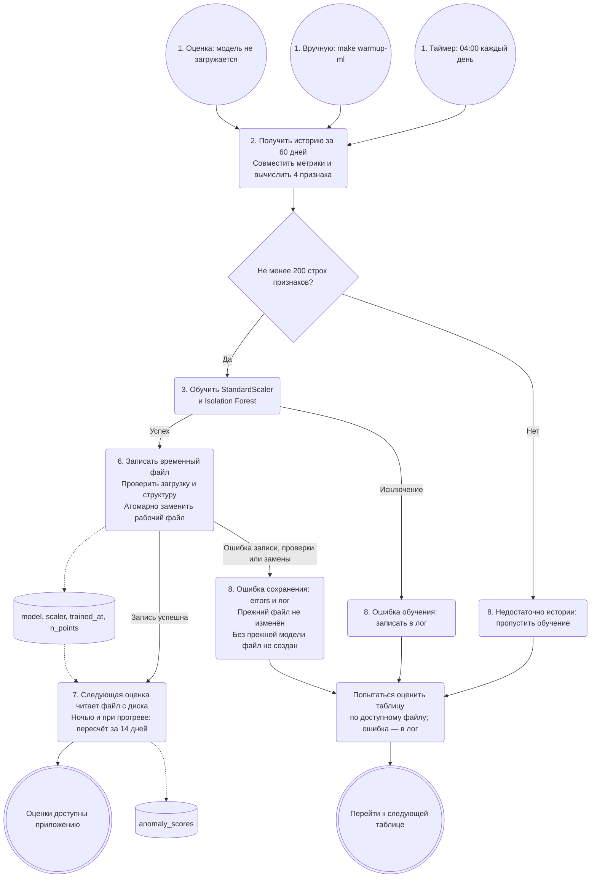
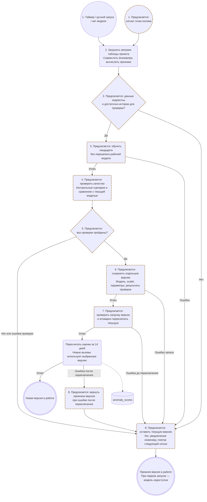

# Автоматическое переобучение модели поиска аномалий

ДЗ 3. Дата сверки: **21 октября 2026 года**, основа —
[`f6b5747`](https://github.com/ksdergach/db-monitoring-production-standards/tree/f6b5747),
сохранение модели обновлено в рамках [#57](https://github.com/ksdergach/db-monitoring-production-standards/issues/57).
Описан основной режим проектов с подключениями, без отдельного разбора `legacy`.
Единица процесса — пара **«проект, таблица»**: у каждой своя модель
Isolation Forest со StandardScaler.

**Ответ на вопрос задания.** Сейчас обучение запускается каждую ночь в 04:00
по часовому поясу планировщика сервера, вручную командой
`make warmup-ml PROJECT_ID=<id>` или при оценке, если файл модели отсутствует
либо не загружается. Проверяется достаточность истории; отдельной проверки
качества новой модели нет. Перед заменой рабочего файла проверяются загрузка
и структура временного артефакта. После успешной атомарной замены модель доступна
следующему вызову оценки. **Предлагается** обучать кандидата отдельно от рабочего
файла, проверять данные и качество, сохранять версию и переключать рабочую
модель только при успешных проверках. При отказе сохранять прежнюю версию,
уведомлять инженера и повторять попытку следующей ночью. Внеплановый запуск
по найденной точке излома также **предлагается**, но ещё не реализован.

## 1. Текущий процесс

В [`collectors/scheduler.py`](../collectors/scheduler.py) задача
`retrain_anomaly_detectors` обходит проекты с метриками и вызывает `retrain_all`
для их таблиц. После обхода обучения она отдельно пытается пересчитать оценки
за 14 дней для всех таблиц, в том числе пропущенных при обучении.

Схема обобщает обработку таблицы в ночном/ручном обходе. Для обучения по запросу
нет обхода таблиц: результат или исключение возвращается вызывающему коду.
После сбора без общего сбоя с записанными метриками независимо от Telegram
оцениваются последние **24 часа** (см. [оперативную схему](Model_BPMN.md));
ночью и при ручном прогреве — **14 дней**. Если файла нет, `score_table`
сам вызывает `train` и повторяет загрузку. Поэтому после неудачи ночного
обучения возможна ещё одна попытка в фазе оценки.

Этапы **4 — проверка качества** и **5 — решение о публикации** сейчас отсутствуют.
Этап 6 — проверка артефакта и атомарная замена одного файла, без регистрации
версии и хранения предыдущих файлов. Проверка структуры не оценивает качество
обнаружения аномалий. Этап 7 — использование
файла при следующей оценке, а не отдельный сервис деплоя.

## 2. Предлагаемый процесс: все восемь этапов задания

Это проект улучшения для [#42](https://github.com/ksdergach/db-monitoring-production-standards/issues/42),
**не описание уже работающей автоматизации**. Пунктирной рамкой и словом
«предлагается» отмечены новые действия. Для реализации потребуется разделить
обучение и запись: текущая функция `train` сразу сохраняет модель.

**Легенда BPMN для обеих схем:** это Mermaid flowchart с элементами BPMN,
а не исполняемая BPMN-модель.

| Элемент | Обозначение | Значение |
| --- | --- | --- |
| Событие начала | Круг | Таймер, ручной запрос или отсутствие модели |
| Задача | Скруглённый прямоугольник | Действие, например обучение |
| Развилка | Ромб | Выбор пути по условию |
| Событие завершения | Двойной круг | Результат обработки |
| Хранилище | Цилиндр | Файл модели или таблица оценок |
| Поток управления | Сплошная стрелка | Порядок действий; подпись задаёт условие |
| Связь с данными | Пунктирная стрелка | Чтение или запись данных |
| Предлагаемое действие | Пунктирная рамка и текст «предлагается» | Требует реализации в #42; цвет не является единственным отличием |

## 3. Этапы и передаваемые результаты

| Этап | Сейчас | Предлагается | Что передаётся дальше |
| --- | --- | --- | --- |
| **1. Триггер** | Ночь в 04:00, ручной прогрев или обучение при оценке без загружаемой модели. | Добавить запуск по подтверждённой точке излома. Часовой поиск изломов уже есть, связи с переобучением нет. | Идентификатор проекта, таблица, причина и время запуска. |
| **2. Получение и подготовка данных** | История за 60 дней; пересечение timestamps `row_count` и `null_rate`; четыре признака. Первая точка исключается после вычисления разностей. Минимум 200 строк признаков, то есть 201 согласованный замер. | Проверять конечность чисел, `row_count >= 0`, `0 <= null_rate <= 1`; отделить контрольный период от обучения. Некорректные или недостаточные данные — отказ от публикации. | Матрица признаков с временными метками; в предлагаемом процессе — раздельные обучающая и контрольная выборки, протокол проверки данных. |
| **3. Обучение** | `StandardScaler.fit_transform`, затем `IsolationForest.fit`: 100 деревьев, `contamination=0.01`, `random_state=42` по умолчанию. | Обучать пару «модель + scaler» как кандидата, не затрагивая рабочий файл. | Модель, scaler, время обучения и число обучающих точек. |
| **4. Проверка качества** | Отсутствует для новой ночной модели. | Контроль нормального ряда и всплеска; сравнение доли аномалий с текущей моделью на одинаковых данных. Правила ниже. | Отчёт с метриками, порогами и результатом каждой проверки. |
| **5. Решение о публикации** | Решения по качеству нет: после проверки загрузки и структуры артефакт заменяет рабочий файл. | Публиковать только при успехе всех обязательных проверок; ошибка проверки считается отказом. | Разрешение на сохранение и активацию версии либо причина отказа. |
| **6. Регистрация / сохранение версии** | Уникальный временный файл в каталоге модели, проверка загрузки и структуры, атомарная замена `.joblib`. Путь включает проект и таблицу. Payload прежний: `model`, `scaler`, `trained_at`, `n_points`; предыдущие версии не хранятся. | Записывать отдельный файл версии и метаданные: параметры, версии библиотек, коммит кода, границы выборок, результаты проверок. Хранить несколько последних версий; связано с [#21](https://github.com/ksdergach/db-monitoring-production-standards/issues/21). | Проверяемый артефакт, идентификатор версии, путь и протокол качества. |
| **7. Деплой** | `score_table` каждый раз загружает файл с диска; новая запись становится рабочей без перезапуска приложения. Ночью после обучения сохраняются оценки за 14 дней. | Проверить чтение артефакта, затем атомарно переключить указатель текущей версии и пересчитать оценки. При откате пересчитать их прежней моделью, чтобы не смешивать результаты. | Рабочая версия и оценки `ts`, `score`, `is_anomaly` в `anomaly_scores`, привязанные к проекту и таблице. |
| **8. Действия при провале** | Недостаток истории увеличивает `skipped`; ошибка обучения, записи, проверки артефакта или замены — `errors`. Прежний файл остаётся неизменным, временный удаляется при обрабатываемой ошибке. `trained` растёт только после успешной публикации. Ошибки оценки обрабатываются отдельно. | До переключения оставить текущую версию; после переключения при ошибке вернуть предыдущую. Уведомить инженера в Telegram при настроенном канале, сохранить причину в логе и повторить по следующему ночному таймеру. | Прежняя рабочая версия и сведения об отказе; при холодном старте без прежней версии — явная недоступность оценки. |

Настройки по умолчанию находятся в [`ml/settings.py`](../ml/settings.py)
и переопределяются через `ML_ANOMALY_*`. Признаки:
`row_count`, `null_rate`, `d_row_count`, `d_null_rate`; разности считаются
между соседними согласованными замерами, без нормировки на время между ними.
Исходные метрики обычно собираются каждые 15 минут, диапазон настройки
подключения — 5–1440 минут.

## 4. Предлагаемые правила допуска новой модели

Правила ниже — проект решения для #42, а не существующие проверки или
доказанные эксплуатационные пороги. Реальные инциденты пока не размечены.

1. **Подготовить независимый контроль.** Например, последние 14 дней из окна
   60 дней оставить для сравнения, а кандидата обучить на более ранней части.
   После разбиения обучающая часть должна содержать минимум 200 строк признаков;
   недостаточный контроль означает отказ с объяснением. Рабочие 60 дней обучения
   сейчас не разбиваются таким образом — это изменение предлагаемого процесса.
2. **Проверить нормальное поведение и всплеск.** Использовать контрольные
   сценарии по образцу D1/D2: на нормальном ряду доля отметок меньше 5 %,
   во временном интервале известного всплеска есть хотя бы одна отметка.
   Для проверки конкретной модели сценарии должны соответствовать масштабу
   и режиму её таблицы и не входить в обучение кандидата. Нельзя напрямую
   проверять модель произвольной таблицы на абсолютных значениях D1/D2
   и считать результат доказательством качества. Метод построения таких
   сценариев и их пригодность должен утвердить инженер до включения допуска.
3. **Сравнить с текущей моделью.** Обе пары «модель + свой scaler» оценивают
   одни и те же контрольные точки за 14 дней. Пример предварительного правила:
   доля аномалий кандидата не выше доли текущей модели более чем на **5 процентных
   пунктов**. Порог требует проверки на истории; скачок доли может быть и реальным
   инцидентом, поэтому отказ должен содержать данные для разбора инженером.
4. **Принять решение.** Все применимые проверки должны пройти. При первом
   запуске сравнивать не с чем: явно зафиксировать отсутствие базовой модели
   и требовать независимые контрольные сценарии. Если их ещё нет, автоматическая
   публикация блокируется. Отсутствие предыдущей модели не отменяет остальные
   проверки и не означает, что данные нормальны.

Тесты [`tests/ml_golden/`](../tests/ml_golden/) проверяют **код алгоритма** в CI,
а не каждую новую модель при ночном переобучении. В текущих эталонных тестах
обучение и оценка выполняются на одном синтетическом ряду; результаты D1/D2
из [Model Card](model_card.md) нельзя выдавать за независимый контроль кандидата.

## 5. Ошибки и границы гарантий текущего кода

В [`ml/anomaly_detector.py`](../ml/anomaly_detector.py) `joblib.dump` пишет
в уникальный временный файл в том же каталоге, что и рабочая модель. После
сброса буфера и `fsync` файл закрывается и загружается заново. Проверяются
наличие полей, типы и обученность Isolation Forest и StandardScaler,
четыре входных признака, положительное целое число точек и дата обучения.
Затем `Path.replace` атомарно заменяет рабочий файл в пределах одной файловой
системы. До замены читатели видят прежнюю целую модель, после — новую.

Ошибка записи, загрузки, структуры или замены передаётся вызывающему коду.
Прежний рабочий файл не изменяется; при первом обучении повреждённый рабочий
файл не появляется. Временный файл удаляется при обрабатываемом сбое.
`retrain_all` увеличивает `errors` и продолжает обход, а `trained` увеличивается
только после успешной публикации. Эти сценарии проверяются в
[`tests/test_anomaly_persistence.py`](../tests/test_anomaly_persistence.py).

Это защита сохранения артефакта, **не проверка качества модели**. Истории версий
и отката после успешной замены пока нет. Одновременные запуски используют разные
временные файлы; последняя успешная замена становится рабочей. Гарантия очистки
не распространяется на принудительное завершение процесса и отказ самой
файловой системы; восстановление после отключения питания не проверялось.

Пересчёт оценок в планировщике идёт независимо от счётчиков обучения. Если
сохранилась рабочая прежняя модель, используется она; если файл не загружается,
`score_table` пытается обучить модель снова. Неуспешная оценка попадает в лог,
штатного отката и уведомления о провале переобучения сейчас нет. Отдельного
уведомления об ошибке обучения не следует путать с существующими уведомлениями
об аномалиях данных и точках излома.

Модель прогноза из [`ml/forecast.py`](../ml/forecast.py) переобучается аналогичным
ночным обходом в **03:00**, отдельной задачи проверки качества новой версии
перед заменой файла также нет.

## Связанные материалы

- [Карточка модели](model_card.md): назначение, параметры, метрики и ограничения.
- [Место модели в процессе](Model_BPMN.md): сбор, оценка, дашборд и уведомления.
- [#42 — реализация проверок качества и версий](https://github.com/ksdergach/db-monitoring-production-standards/issues/42).
- [Планировщик](../collectors/scheduler.py), [ручной прогрев](../scripts/warmup_ml.py),
  [оценка после сбора](../collectors/per_project.py), [пути файлов моделей](../ml/common.py).
