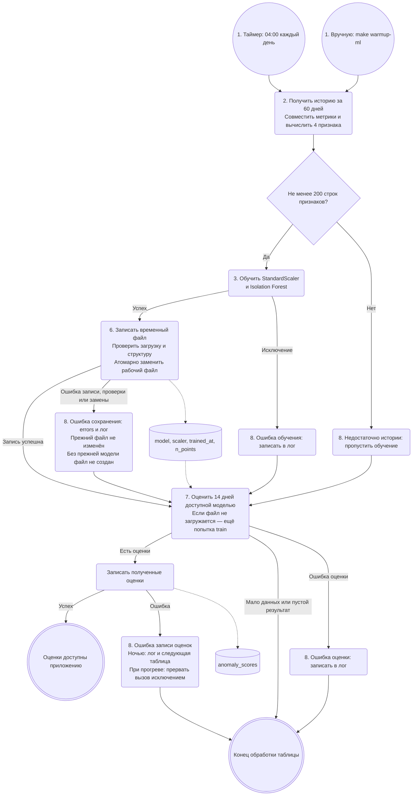
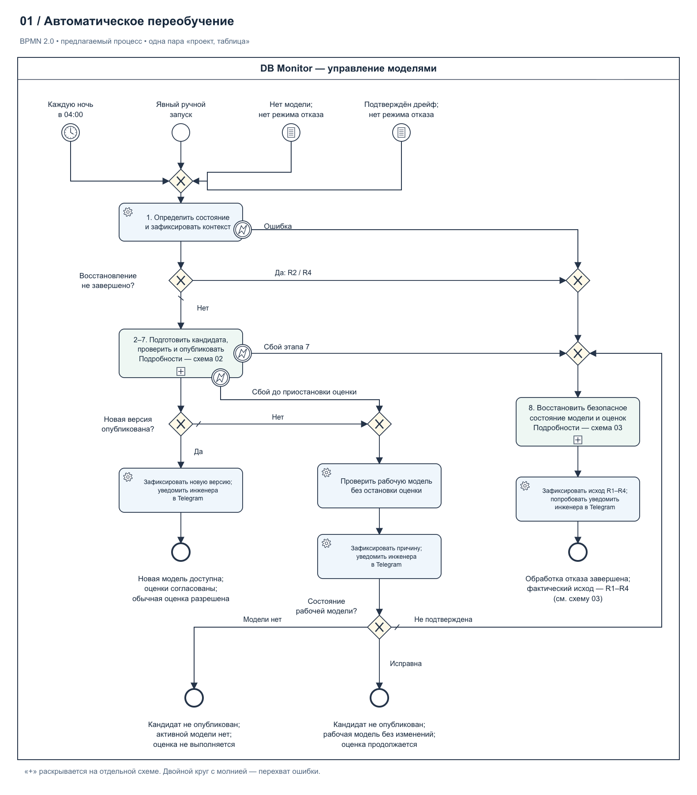
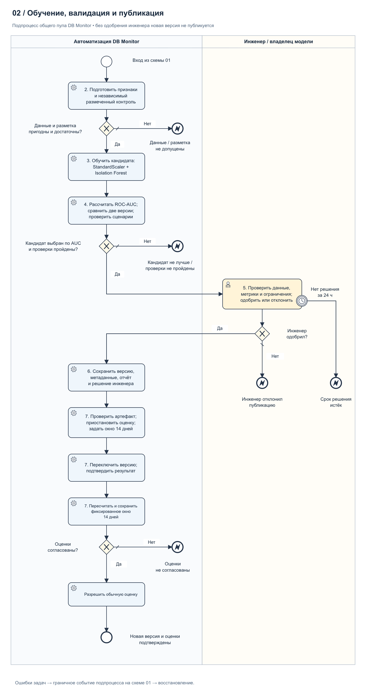
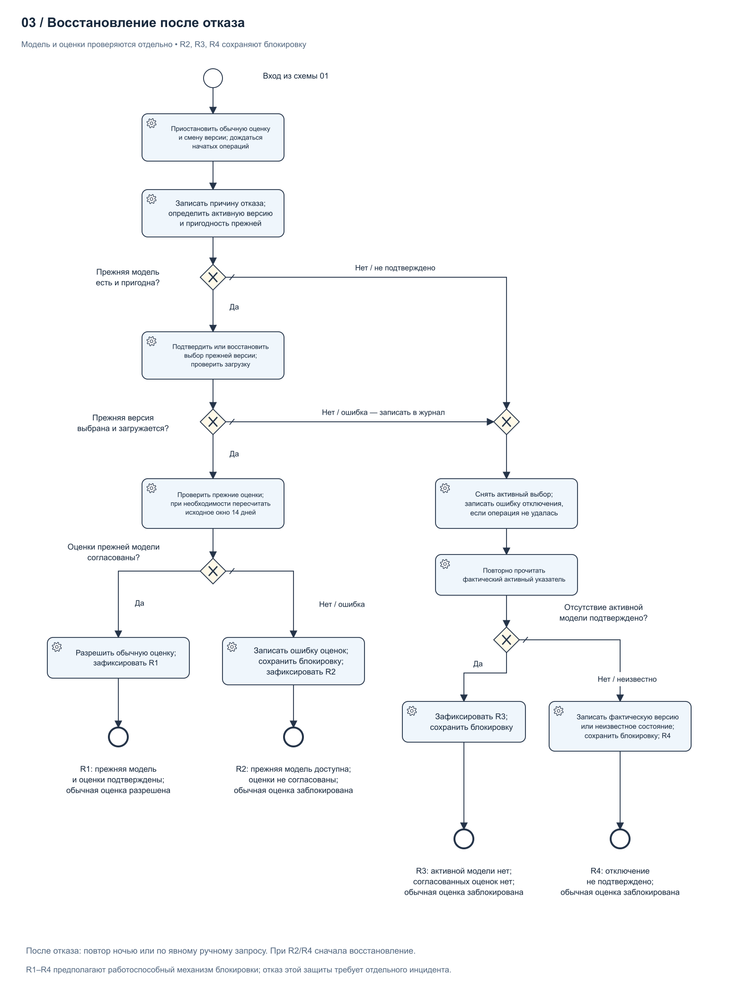

# Автоматическое переобучение модели поиска аномалий — версия 2

**Версия 2.** Предлагаемый процесс в BPMN 2.0 с AUC и обязательной валидацией инженером. [Исходная версия](../Model_retrain_BPMN.md) сохранена отдельно.

ДЗ 3. Дата сверки: **24 октября 2026 года**, код —
[`8d1c53d`](https://github.com/ksdergach/db-monitoring-production-standards/tree/8d1c53df4710fec8cef2b48d0f2021c25faad916).
Описан основной режим проектов с подключениями, без отдельного разбора `legacy`.
Единица процесса — пара **«проект, таблица»**: у каждой своя модель
Isolation Forest со StandardScaler.

**Ответ на вопрос задания.** Сейчас обучение запускается каждую ночь в 04:00
по часовому поясу планировщика сервера, вручную командой
`make warmup-ml PROJECT_ID=<id>` или при оценке, если файл модели отсутствует
либо не загружается. Проверяется достаточность истории; отдельной проверки
качества новой модели нет. Перед заменой рабочего файла проверяются загрузка
и структура временного артефакта. После успешной атомарной замены модель доступна
следующему вызову оценки. **Предлагается** обучать кандидата отдельно от рабочего
файла, проверять данные и качество, сравнивать версии по ROC-AUC и получать
явное одобрение инженера. Только после этого сохранять версию и переключать
рабочую модель. При отказе проверять фактическую активную
версию, пригодность прежней модели и согласованность её оценок. Если модель
восстановлена, а оценки нет, модель остаётся доступной, но обычная оценка
заблокирована. Если прежнюю модель использовать нельзя, отключать кандидата
и подтверждать отсутствие активной версии. Неподтверждённое отключение — отдельный
исход с зафиксированной фактической версией либо неизвестным состоянием
и заблокированной оценкой. Уведомление инженеру не должно мешать восстановлению;
повтор предлагается следующей ночью или по явному ручному запросу. Дополнительно
**предлагается** запуск по подтверждённому дрейфу распределения метрик. Найденная
точка излома может быть поводом для проверки, но не заменяет подтверждение дрейфа.

## 1. Текущий процесс

В [`collectors/scheduler.py`](../../collectors/scheduler.py) задача
`retrain_anomaly_detectors` обходит проекты с метриками и для каждого проекта
вызывает `retrain_all` по его таблицам. Затем в том же цикле по проекту она
отдельно пытается пересчитать оценки за 14 дней для всех таблиц проекта,
в том числе пропущенных при обучении.

Схема обобщает обработку таблицы в ночном/ручном обходе: сначала обучаются
таблицы проекта, затем выполняется отдельный обход оценки. Доступность файла
модели не гарантирует успешный пересчёт и запись оценок. Для обучения по запросу
нет обхода таблиц: `score_table` вызывает обучение и возвращает результат или
исключение вызывающему коду.
После сбора без общего сбоя с записанными метриками независимо от Telegram
оцениваются последние **24 часа** (см. [оперативную схему](../Model_BPMN.md));
ночью и при ручном прогреве — **14 дней**. Если файла нет, `score_table`
сам вызывает `train` и повторяет загрузку. Поэтому после неудачи ночного
обучения возможна ещё одна попытка в фазе оценки.

Этапы **4 — проверка качества** и **5 — решение о публикации** сейчас отсутствуют.
Этап 6 — проверка артефакта и атомарная замена одного файла, без регистрации
версии и хранения предыдущих файлов. Проверка структуры не оценивает качество
обнаружения аномалий. Этап 7 — использование
файла при следующей оценке, а не отдельный сервис деплоя.

## 2. Предлагаемый процесс: все восемь этапов задания

Это **документальное предложение в рамках #58, не описание работающей
автоматизации**. Схемы целевого процесса выполнены в **BPMN 2.0**;
редактируемая модель и изображения приложены ниже.
[#42](https://github.com/ksdergach/db-monitoring-production-standards/issues/42)
сохранена как справочный контекст бэклога: она не является обязательной зависимостью
этой схемы или утверждённым планом реализации. Python в #58 не изменяется.

В начале попытки фиксируются прежняя версия и контекст, но окно пересчёта
ещё не задаётся. После одобрения инженера, непосредственно перед переключением,
приостанавливаются операции и сохраняются границы последних 14 дней на текущий
момент. Без сохранённого окна переключение запрещено; повтор восстановления
использует те же границы.
Прежней считается версия, работавшая до попытки, а не кандидат.
Наличие её файла не подтверждает пригодность: артефакт должен загружаться,
относиться к нужным проекту и таблице и соответствовать контракту признаков.
При ошибке загрузки прежний файл не считается пригодной рабочей моделью.

**Состояния модели и оценок проверяются отдельно.** Доступность модели ниже
означает, что выбранный артефакт проверен и загружается. Она не разрешает обычные
вызовы оценки, пока их блокировка не снята. Согласованность оценок означает,
что для зафиксированного окна подтверждены их полнота и принадлежность той же
версии модели, проекту и таблице; результаты кандидата с прежними не смешаны.
В предлагаемом процессе для этого нужны сведения о версии и окне расчёта.
В текущей таблице `anomaly_scores` таких сведений нет.

### Основной процесс

Общий процесс показан на схеме 01, подпроцесс обучения и публикации — на
схеме 02. Обработчик этапа 8 раскрыт на схеме 03: проверка и восстановление
прежней версии (8А), при необходимости — отключение кандидата (8Б). Он возвращает
один из исходов R1–R4. Это детализация одного процесса, а не параллельные запуски.

[Крупно](../assets/model_retrain/01_Process_Retrain.png) · [SVG](../assets/model_retrain/01_Process_Retrain.svg) · [Полная BPMN-модель](../assets/model_retrain/Model_retrain.bpmn)

### 2–7. Данные, обучение, проверка и публикация

[Крупно](../assets/model_retrain/02_Publish.png) · [SVG](../assets/model_retrain/02_Publish.svg) · [BPMN с этим представлением первым](../assets/model_retrain/02_Publish.bpmn)

На общей схеме один пул **«DB Monitor — управление моделями»**. Внутри
подпроцесса публикации две дорожки: **«Автоматизация DB Monitor»** выполняет
подготовку, обучение, расчёты и деплой; **«Инженер / владелец модели»** выполняет
обязательную **User Task** проверки отчёта. Сплошная стрелка между дорожками
показывает последовательность действий внутри одного пула.

При пригодной прежней модели для допуска нужны `AUC_new > AUC_old`,
`AUC_new >= AUC_min`, остальные обязательные проверки и явное одобрение
инженера. Ожидание ответа не является одобрением; ручное согласие не отменяет
провал обязательной проверки. Только затем регистрируется версия и начинается
подготовка переключения. Окно пересчёта сохраняется после решения инженера,
перед активацией. Правила первого допуска приведены в разделе 4.

### 8А. Проверка состояния и восстановление прежней версии

Обработчик приостанавливает обычные вызовы оценки и смены версии для этой пары,
дожидается завершения уже начатых операций. Служебные действия восстановления
разрешены. Так кандидат не продолжает публиковать результаты во время отката.
Проверка фактического указателя нужна и при неизвестном результате переключения.

[Крупно](../assets/model_retrain/03_Recover.png) · [SVG](../assets/model_retrain/03_Recover.svg) · [BPMN с этим представлением первым](../assets/model_retrain/03_Recover.bpmn)

Даже при отказе до переключения путь R1 требует проверки прежней модели
и её оценок. Если окно ещё не сформировано и переключения не было, последние
14 дней задаются после остановки операций при входе в восстановление и сохраняются
для повторов. При возможном переключении и неизвестном сохранённом окне R1
запрещён: нельзя подставить новый период и объявить прежние оценки согласованными. Неизменность файлов и записей сама по себе не подтверждает их
пригодность. Если модель вернуть удалось, а оценки пересчитать или сохранить
не удалось, выход R2 сохраняет подтверждённую прежнюю модель; недоступными
считаются согласованные результаты, обычная оценка остаётся заблокированной.

### 8Б. Отключение кандидата и проверка результата

Эта ветка обработчика показана справа на схеме 03 и используется при отсутствии
пригодной прежней модели либо ошибке её восстановления. Она явно снимает активный
выбор, в том числе после первого
запуска с опубликованным кандидатом и ошибкой пересчёта. Артефакт кандидата
можно сохранить для разбора; он не допускается к обычной оценке.

[Ветка отключения показана справа на схеме 03](../assets/model_retrain/03_Recover.png).

При R4 кандидат или иная версия могут оставаться выбранными указателем;
это фиксируется, если указатель удалось прочитать. Если чтение не удалось,
состояние записывается как неопределённое. Модель не объявляется отключённой.
Защиту обеспечивает сохранённая блокировка обычной оценки и публикации результатов,
а не предположение об успешном отключении.

### Конечные состояния и повтор после отказа

| Исход | Состояние модели | Состояние оценок и обычных вызовов |
| --- | --- | --- |
| Успешное обновление | Новая версия выбрана, проверена и загружается. | Оценки согласованы; обычная оценка разрешена. |
| R1 | Прежняя версия выбрана, проверена и загружается. | Оценки согласованы; обычная оценка разрешена. |
| R2 | Прежняя версия выбрана, проверена и загружается. | Согласованность оценок не подтверждена; обычная оценка заблокирована. |
| R3 | Отсутствие активной версии подтверждено повторным чтением указателя. | Согласованных оценок нет; обычная оценка заблокирована. |
| R4 | Отключение не подтверждено: записана фактически выбранная версия либо неизвестное состояние. | Оценки не допускаются к использованию как согласованные; обычная оценка заблокирована. |

Для любого отказа фиксируются причина, фактический выбор модели, состояние
оценок и отдельные ошибки восстановления/отключения. Уведомление инженеру
отправляется при настроенном Telegram; ошибка доставки не отменяет восстановление,
блокировку или последующий повтор. Исторические записи не удаляются автоматически,
но не выдаются за подтверждённую актуальную оценку.

**Сейчас:** при отсутствии или ошибке загрузки файла `score_table` вызывает
`train` в том же запросе. Это возможно и в фазе оценки после неудачи ночного
обучения, и при очередном оперативном сборе. Режима ожидания ночного повтора нет.

**Предлагается:** после отказа новые обычные запросы не запускают обучение
повторно. Следующая попытка — по ночному таймеру либо явному ручному запуску.
При R2/R4 запуск выполняет только повторное восстановление по схеме 03 с исходным
окном расчёта: новый кандидат в этом запуске не обучается и до разрешения этого
состояния не публикуется. При R1/R3
следующий запуск может начать новую попытку обучения после проверки состояния.
Возобновление обычной оценки разрешено только после успешного обновления или R1.
Неуспешные попытки подряд для одной пары подсчитываются; начиная с третьей,
уведомление требует от инженера разобрать причину, например дрейф, нехватку
разметки или недостижимый порог. Повторы восстановления при R2/R4 при этом
не прекращаются.
Эта политика повторов и блокировок пока не реализована.

Справочная схема текущего кода в разделе 1 выполнена в Mermaid. Для целевого
процесса в разделе 2 используется **BPMN 2.0**:

| Элемент | Обозначение | Значение |
| --- | --- | --- |
| Пул | Внешняя рамка с названием участника | «DB Monitor — управление моделями», внутри которого выполняется процесс |
| Дорожка | Раздел внутри процесса | Ответственность автоматизации или инженера |
| Событие начала | Круг с тонкой границей | Таймер, ручной запуск, отсутствие модели или подтверждённый дрейф |
| Автоматическая задача | Скруглённый прямоугольник с шестерёнкой | Подготовка данных, обучение, расчёт метрик и переключение версии |
| User Task | Скруглённый прямоугольник с человеком | Обязательное решение инженера о публикации кандидата |
| Исключающий шлюз | Ромб с `X` | Выбор ветки либо объединение альтернативных путей |
| Подпроцесс | Скруглённый прямоугольник с `+` | Детализация на другой схеме той же модели |
| Граничная ошибка | Двойной круг с контурной молнией | Прерывание задачи или подпроцесса и переход к восстановлению |
| Граничный таймер | Двойной круг с часами | Срок решения инженера (24 ч) истёк: задача прерывается, кандидат не одобрен |
| Завершение с ошибкой | Круг с толстой границей и чёрной молнией | Отказ внутри подпроцесса, который перехватывается на его границе |
| Обычное завершение | Круг с толстой границей | Успешная публикация либо записанный результат обработки отказа |
| Поток последовательности | Сплошная стрелка | Порядок действий, в том числе между дорожками одного пула |

Три BPMN-файла содержат одну полную описательную модель с разным первым
представлением. Модель не подключена к BPMN-движку. Технические исключения
автоматических задач потребуется переводить в BPMN Error при реализации.

## 3. Этапы и передаваемые результаты

| Этап | Сейчас | Предлагается | Что передаётся дальше |
| --- | --- | --- | --- |
| **1. Триггер** | Ночь в 04:00, ручной прогрев или обучение при оценке без загружаемой модели; отдельного запрета повтора после отказа нет. | Добавить запуск по подтверждённому дрейфу распределения метрик. После отказа — ночной или явный ручной повтор; при R2/R4 сначала завершить восстановление. Обычный запрос в режиме отказа обучение не запускает. | Проект, таблица, причина запуска, прежняя версия и режим после отказа. Окно пересчёта ещё не задано. |
| **2. Получение и подготовка данных** | История за 60 дней; пересечение timestamps `row_count` и `null_rate`; четыре признака. Первая точка исключается после вычисления разностей. Минимум 200 строк признаков, то есть 201 согласованный замер. | Проверять конечность чисел, `row_count >= 0`, `0 <= null_rate <= 1`; подготовить размеченный контроль с обоими классами, независимый от обучения обеих моделей и их scaler. Некорректные или недостаточные данные — отказ от публикации. | Матрица признаков с временными метками; в предлагаемом процессе — раздельные обучающая и контрольная выборки, метки и подтверждение независимости. |
| **3. Обучение** | `StandardScaler.fit_transform`, затем `IsolationForest.fit`: 100 деревьев, `contamination=0.01`, `random_state=42` по умолчанию. | Обучать пару «модель + scaler» как кандидата, не затрагивая рабочий файл. | Модель, scaler, время обучения и число обучающих точек; в предлагаемом процессе — идентификатор кандидата (например, SHA-256 артефакта), на который ссылаются отчёт и решение инженера. |
| **4. Проверка качества** | Отсутствует для новой ночной модели. | Сравнить ROC-AUC двух версий на одинаковом независимом контроле: `AUC_new > AUC_old` и `AUC_new >= AUC_min`; проверить нормальный ряд, всплеск и остальные обязательные условия. Для первого запуска действуют абсолютные критерии. Правила ниже. | Отчёт с AUC, результатами обязательных проверок и ограничениями; отсутствие пригодной базы фиксируется отдельно. |
| **5. Решение о публикации** | Решения по качеству нет: после проверки загрузки и структуры артефакт заменяет рабочий файл. | После автоматического допуска выполнить обязательную User Task: инженер проверяет отчёт и явно одобряет или отклоняет конкретного кандидата. Ожидание не является одобрением; провал обязательной проверки не обходится ручным согласием. Срок решения — 24 ч: по его истечении задача прерывается граничным таймером, кандидат не публикуется. | Явное решение инженера по идентификатору кандидата с автором, временем и обоснованием либо причина отказа, в том числе истечение срока. |
| **6. Регистрация / сохранение версии** | Уникальный временный файл в каталоге модели, проверка загрузки и структуры, атомарная замена `.joblib`. Путь включает проект и таблицу. Payload прежний: `model`, `scaler`, `trained_at`, `n_points`; предыдущие версии не хранятся. | Регистрировать только артефакт, идентификатор которого указан в решении инженера. Записывать отдельный файл версии и метаданные: проект, таблица, параметры, версии библиотек, коммит кода, границы выборок, результаты проверок. Хранить несколько последних версий; [#21](https://github.com/ksdergach/db-monitoring-production-standards/issues/21) — справочный контекст метаданных. | Проверяемый артефакт, идентификатор версии, путь и протокол качества. |
| **7. Деплой** | `score_table` каждый раз загружает файл с диска; новая запись становится рабочей без перезапуска приложения. Ночью после обучения сохраняются оценки за 14 дней. | После одобрения проверить артефакт и актуальность решения, приостановить операции и дождаться текущих вызовов. Задать и сохранить последние 14 дней непосредственно перед переключением. Переключить указатель, пересчитать сохранённое окно и подтвердить результаты; только затем разрешить обычные вызовы. При ошибке — этап 8. | Подтверждённая активная модель и согласованные оценки за сохранённое окно либо причина отказа и фактическое состояние для восстановления. |
| **8. Действия при провале** | Недостаток истории увеличивает `skipped`; ошибка обучения, записи, проверки артефакта или замены — `errors`. Прежний файл остаётся неизменным, временный удаляется при обрабатываемой ошибке. `trained` растёт только после успешной публикации. Ошибки оценки обрабатываются отдельно; ночной обход продолжает работу, ошибка записи оценок при ручном прогреве прерывает его. | Приостановить обычные операции; определить фактический указатель и повторно проверить пригодность прежней версии. Подтвердить её выбор и согласованность оценок либо выполнить возврат и пересчёт. Без пригодной прежней модели или при ошибке её восстановления — снять активный выбор и проверить отключение по 8Б. Отдельно журналировать ошибки восстановления модели, оценок и отключения. Уведомление не блокирует обработку; повтор — по правилам R1–R4. | R1: прежняя модель и оценки подтверждены. R2: прежняя модель доступна, оценки не согласованы. R3: активной модели нет, согласованных оценок нет. R4: отключение не подтверждено, фактическое состояние записано. При R2/R3/R4 обычная оценка заблокирована. |

Настройки по умолчанию находятся в [`ml/settings.py`](../../ml/settings.py)
и переопределяются через `ML_ANOMALY_*`. Признаки:
`row_count`, `null_rate`, `d_row_count`, `d_null_rate`; разности считаются
между соседними согласованными замерами, без нормировки на время между ними.
Исходные метрики обычно собираются каждые 15 минут, диапазон настройки
подключения — 5–1440 минут.

## 4. Предлагаемые правила допуска новой модели

Правила ниже — документальное предложение, а не существующие проверки или
доказанные эксплуатационные пороги. Реальные инциденты пока не размечены.
В рамках этого ДЗ независимый контроль не создавался, AUC не рассчитывался.
Пока нет размеченного контроля (реального или явно обозначенного синтетического),
п. 1 блокирует публикацию любого кандидата.

1. **Подготовить независимый контроль.** Он содержит подтверждённые нормальные
   и аномальные случаи и не входит в обучение ни кандидата, ни прежней модели,
   включая их scaler. Можно рассматривать отделение последних 14 дней от окна
   60 дней, но только если доказано, что прежняя модель тоже не обучалась на этих
   точках. При ежедневной успешной публикации это не выполняется: прежняя модель
   обучена накануне на окне, которое покрывает почти все эти дни. После разбиения для обучения нужны минимум 200 строк признаков.
   Неподтверждённая независимость, недостаточный контроль или отсутствие меток
   блокируют публикацию; простого разбиения данных только кандидата недостаточно.
2. **Проверить нормальное поведение и всплеск.** Использовать контрольные
   сценарии по образцу D1/D2: на нормальном ряду доля отметок меньше 5 %,
   во временном интервале известного всплеска есть хотя бы одна отметка.
   Для проверки конкретной модели сценарии должны соответствовать масштабу
   и режиму её таблицы и не входить в обучение кандидата. Нельзя напрямую
   проверять модель произвольной таблицы на абсолютных значениях D1/D2
   и считать результат доказательством качества. Метод построения таких
   сценариев и их пригодность должен утвердить инженер до включения допуска.
3. **Сравнить ROC-AUC.** Обе версии оценивают одинаковые контрольные точки,
   каждая со своим scaler. Пригодный кандидат должен выполнить одновременно
   `AUC_new > AUC_old` и `AUC_new >= AUC_min`. Метки контроля задаются независимо:
   `1` — известная аномалия, `0` — норма; для AUC используются непрерывные
   неокруглённые `-decision_function`, поскольку меньшая оценка Isolation Forest
   означает более сильную аномальность. `AUC_min` утверждается до оценки;
   пример 0,8 из лекции не выдаётся за норматив проекта. Равенство, ухудшение
   или невозможность расчёта означают отказ. Для первого запуска без пригодной
   прежней модели сравнение отсутствует, но `AUC_new >= AUC_min` и абсолютные
   контрольные сценарии остаются обязательными.
4. **Дополнительно сравнить долю аномалий, если прежняя модель есть.** Обе пары
   «модель + свой scaler» оценивают одни и те же точки рабочих данных
   за последние 14 дней. Это не независимый контроль из п. 1: прежняя модель
   обычно обучалась на большей части этих точек, поэтому сравнение долей
   дополняет п. 1–3, но не заменяет их. Пример предварительного правила:
   доля аномалий кандидата не выше доли прежней рабочей модели более чем на **5 процентных
   пунктов**. Порог требует проверки на истории; скачок доли может быть и реальным
   инцидентом, поэтому отказ должен содержать данные для разбора инженером.
5. **Получить решение инженера.** Все обязательные проверки должны пройти,
   затем выполняется User Task: инженер проверяет отчёт, ограничения и явно
   одобряет либо отклоняет конкретного кандидата по его идентификатору.
   Отсутствие ответа не считается одобрением: срок решения — 24 ч, после него
   кандидат не публикуется. Обязательный провал нельзя обойти ручным согласием.
   Решение сохраняется с автором, временем и обоснованием. Отсутствие прежней модели
   фиксируется отдельно и не отменяет проверки или ручную валидацию.

Тесты [`tests/ml_golden/`](../../tests/ml_golden) проверяют **код алгоритма** в CI,
а не каждую новую модель при ночном переобучении. В текущих эталонных тестах
обучение и оценка выполняются на одном синтетическом ряду; результаты D1/D2
из [Model Card](../model_card.md) нельзя выдавать за независимый контроль кандидата.

## 5. Ошибки и границы гарантий текущего кода

В [`ml/anomaly_detector.py`](../../ml/anomaly_detector.py) `joblib.dump` пишет
в уникальный временный файл в том же каталоге, что и рабочая модель. После
сброса буфера и `fsync` файл закрывается и загружается заново. Проверяются
наличие полей, типы и обученность Isolation Forest и StandardScaler,
четыре входных признака, положительное целое число точек и дата обучения.
Затем `Path.replace` атомарно заменяет рабочий файл в пределах одной файловой
системы. До замены читатели видят прежнюю целую модель, после — новую.

Ошибка записи, загрузки, структуры или замены передаётся вызывающему коду.
Прежний рабочий файл не изменяется; при первом обучении повреждённый рабочий
файл не появляется. Временный файл удаляется при обрабатываемом сбое.
`retrain_all` увеличивает `errors` и продолжает обход, а `trained` увеличивается
только после успешной публикации. Эти сценарии проверяются в
[`tests/test_anomaly_persistence.py`](../../tests/test_anomaly_persistence.py).

Это защита сохранения артефакта, **не проверка качества модели**. Истории версий
и отката после успешной замены пока нет. Одновременные запуски используют разные
временные файлы; последняя успешная замена становится рабочей. Гарантия очистки
не распространяется на принудительное завершение процесса и отказ самой
файловой системы; восстановление после отключения питания не проверялось.

Пересчёт оценок в планировщике идёт независимо от счётчиков обучения. Если
сохранилась рабочая прежняя модель, используется она; если файл не загружается,
`score_table` пытается обучить модель снова. Неуспешная оценка попадает в лог,
штатного отката и уведомления о провале переобучения сейчас нет. Отдельного
уведомления об ошибке обучения не следует путать с существующими уведомлениями
об аномалиях данных и точках излома.

Модель прогноза из [`ml/forecast.py`](../../ml/forecast.py) переобучается аналогичным
ночным обходом в **03:00**, отдельной задачи проверки качества новой версии
перед заменой файла также нет.

## Связанные материалы

- [Карточка модели](../model_card.md): назначение, параметры, метрики и ограничения.
- [Место модели в процессе](../Model_BPMN.md): сбор, оценка, дашборд и уведомления.
- [#42 — справочный контекст бэклога проверок качества и версий](https://github.com/ksdergach/db-monitoring-production-standards/issues/42), не обязательная зависимость #58.
- [Планировщик](../../collectors/scheduler.py), [ручной прогрев](../../scripts/warmup_ml.py),
  [оценка после сбора](../../collectors/per_project.py), [пути файлов моделей](../../ml/common.py).
